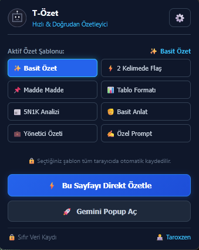
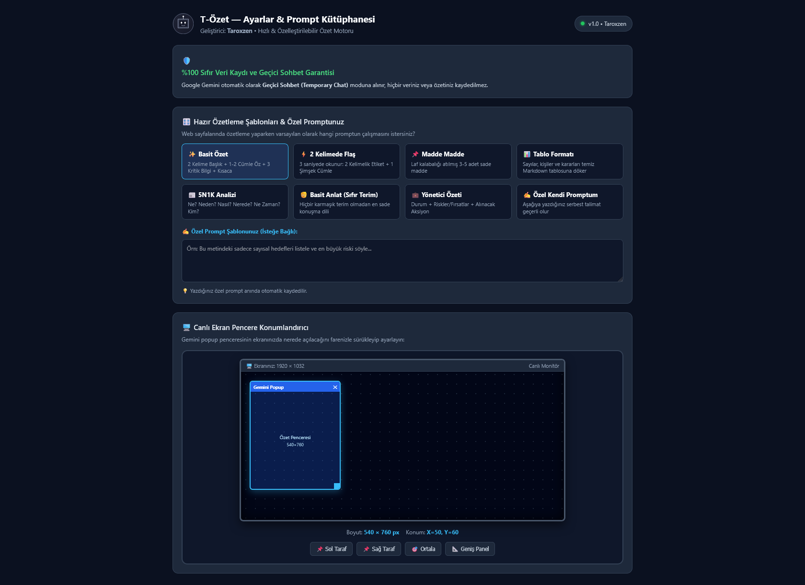
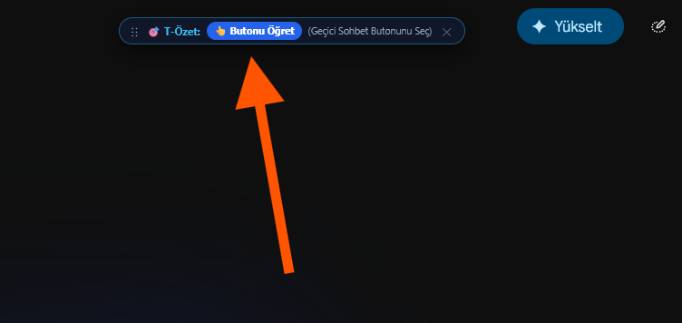

# ⚡ T-Özet — Akıllı Web & Haber Özetleyici

<div align="center">


**Web sayfalarındaki reklam, clickbait ve SEO çöplerini ayıklayarak Google Gemini üzerinden tek tıkla minimalist ve yapısal özetler çıkaran modern tarayıcı eklentisi.**

[Kurulum](#-kurulum-rehberi) • [Ekran Görüntüleri](#-ekran-görüntüleri) • [Özellikler](#-öne-çıkan-özellikler) • [Şablonlar](#-8-akıllı-prompt-şablonu) • [Mimari](#-proje-yapısı)

</div>

---

## 📸 Ekran Görüntüleri

### 1. 🎛️ Eklenti Açılır Menüsü (8 Akıllı Şablon & Hızlı Aksiyon)
> Tarayıcınızın sağ üstündeki menüden istediğiniz şablonu seçip tek tıkla mevcut sayfayı doğrudan özetleyebilirsiniz.

<div align="center">
  
</div>

---

### 2. 🖥️ Ayarlar Sayfası & Canlı Monitör Pencere Konumlandırıcı
> Gemini özet penceresinin ekranınızın neresinde ve hangi boyutta açılacağını interaktif masaüstü monitör önizlemesinden farenizle sürükleyip ayarlayabilirsiniz.

<div align="center">
  
</div>

---

### 3. 🎯 Gemini Web Sürüklenebilir Buton Öğretici (Visual Macro Learner)
> Gemini sayfasında beliren sürüklenebilir `[⋮⋮ 🎯 T-Özet: 👆 Butonu Öğret]` çubuğu ile sayfadaki Geçici Sohbet butonunu 1 kez tıklayarak öğretebilir ve canlı test edebilirsiniz.

<div align="center">
  
</div>

---

## ✨ Öne Çıkan Özellikler

- 🚀 **Doğrudan Tek-Tıkla Özetleme:** Sayfada dikkat dağıtan aracı kutular olmadan, seçtiğiniz şablonla anında Gemini popup penceresini açar ve özetler.
- 💎 **✨ Basit Özet (Minimalist Güç):** Tık tuzaklarını ve gereksiz laf kalabalığını atarak 2 Kelime Başlık + 1-2 Cümle Öz + 3 Somut Bilgi + Kısaca formatında damıtılmış bilgi sunar.
- 🎛️ **8 Akıllı Prompt Şablonu:** Basit Özet, 2 Kelimede Flaş, Madde Madde, Tablo, 5N1K, Basit Anlat (ELI5), Yönetici Özeti ve Özel Prompt.
- 🧹 **Sekmeye Bağlı Otomatik Kapanma (Tab-Linked Auto-Close):** Özetlediğiniz haber/web sekmesini kapattığınızda (`Ctrl+W`), bağlı Gemini popup penceresi de otomatik olarak kapanır.
- 🔒 **%100 Sıfır Veri Kaydı (Geçici Sohbet):** Gemini'yi otomatik olarak Geçici Sohbet (Temporary Chat) moduna geçirir, özet geçmişinizi kaydetmez.
- 🎯 **Görsel Buton Öğretici (Visual Macro Learner):** Gemini arayüzündeki butonları tek tıkla yakalayan sürüklenebilir ve sentetik tıklama uyumlu akıllı motor.
- 🖥️ **Canlı Ekran Pencere Konumlandırıcı:** Ayarlar sayfasındaki interaktif masaüstü monitör önizlemesinden popup boyutunu ve konumunu farenizle ayarlayabilme.
- ⌨️ **Hızlı Kısayol Tuşu:** `Alt + S` tuşuna basarak bulunduğunuz sayfayı anında özetleyin.

---

## 🎛️ 8 Akıllı Prompt Şablonu

| İkon | Şablon Adı | Açıklama |
| :--- | :--- | :--- |
| ✨ | **Basit Özet** | 2 Kelime Başlık + 1-2 Cümle Öz + 3 Kritik Somut Bilgi + Kısaca |
| ⚡ | **2 Kelimede Flaş** | 3 saniyede okunur: 2 Kelimelik Etiket + 1 Şimşek Cümle |
| 📌 | **Madde Madde** | Laf kalabalığı atılmış 3-5 adet net ve vurucu madde |
| 📊 | **Tablo Formatı** | Sayılar, kişiler, tarihler ve kararları Markdown tablosuna döker |
| 📰 | **5N1K Analizi** | Ne? Neden? Nasıl? Nerede? Ne Zaman? Kim? gazetecilik analizi |
| 🧒 | **Basit Anlat (ELI5)** | Hiçbir karmaşık/teknik terim olmadan en sade konuşma dili |
| 💼 | **Yönetici Özeti** | Durum + Riskler/Fırsatlar + Alınacak Stratejik Aksiyon |
| ✍️ | **Özel Prompt** | Kendi yazdığınız serbest istemi şablon olarak kullanır |

---

## 🚀 Kurulum Rehberi

### 🌐 Google Chrome / Brave / Edge / Opera:
1. `dist/` klasöründeki **`T-Ozet-Chrome-v1.0.zip`** dosyasını bir klasöre çıkarın *(veya doğrudan `chrome/` klasörünü kullanın)*.
2. Tarayıcınızda `chrome://extensions` adresine gidin.
3. Sağ üstteki **"Geliştirici Modu"**nu (Developer mode) açın.
4. Sol üstteki **"Paketlenmemiş öğe yükle"** (Load unpacked) butonuna tıklayın ve klasörü seçin.

### 🦊 Mozilla Firefox / Zen Browser:
1. Firefox'ta `about:debugging#/runtime/this-firefox` adresine gidin.
2. **"Geçici Eklenti Yükle..."** (Load Temporary Add-on) butonuna tıklayın.
3. `dist/` klasöründeki **`T-Ozet-Firefox-v1.0.zip`** veya `firefox/manifest.json` dosyasını seçin.

---

## 📁 Proje Yapısı

```
T-Ozet/
├── assets/                 # Dokümantasyon ve README ekran görüntüleri
│   ├── eklenti_penceresi.png
│   ├── ayar_sayfasi.png
│   └── gemini_gecici_sohbet_ogretme.png
├── chrome/                 # Google Chrome / Chromium Manifest V3 kaynak kodları
│   ├── background/         # Service Worker & Popup Pencere Yöneticisi
│   ├── content/            # İçerik Ayıklayıcı & Otomatik Doldurucu
│   ├── popup/              # Araç Çubuğu 8 Şablonlu Popup Menüsü
│   ├── options/            # Sürüklenebilir Monitör & Ayarlar Sayfası
│   └── manifest.json       # Chromium MV3 Manifest
├── firefox/                # Mozilla Firefox / Gecko Manifest V3 kaynak kodları
│   └── ...                 # Gecko Xray & Composed Event uyumlu kodlar
├── dist/                   # Kuruluma hazır ZIP & XPI paketleri
├── LICENSE                 # MIT Lisansı
└── README.md               # Görsel Zengin Dokümantasyon
```

---

## 👨‍💻 Geliştirici & Lisans

* **Geliştirici:** [Taroxzen](https://github.com/Taroxzen)
* **Lisans:** MIT Lisansı altında açık kaynaklıdır.